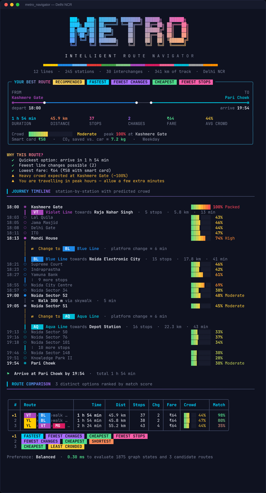
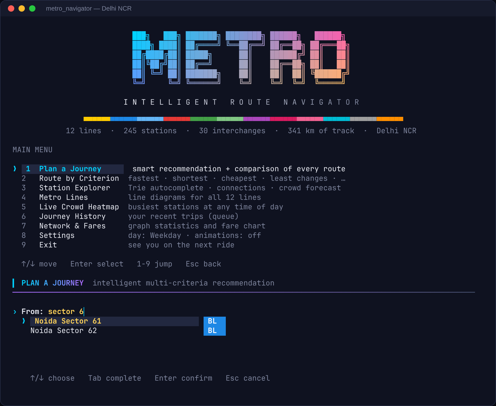
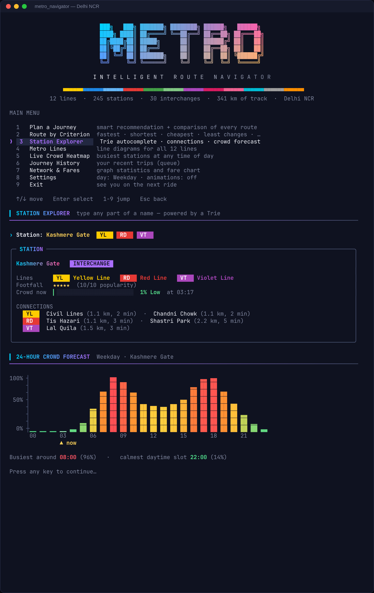
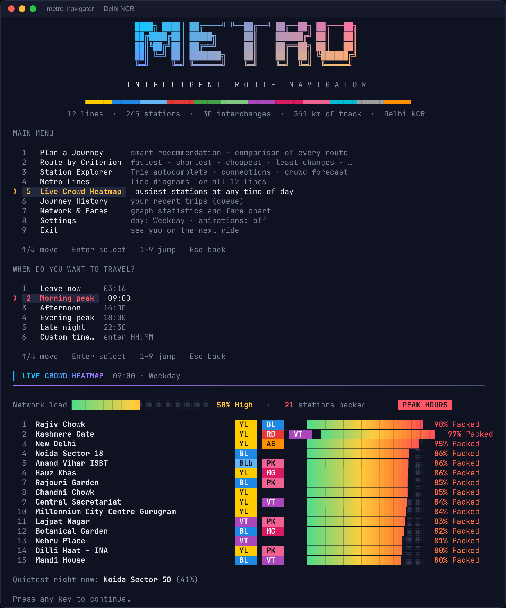
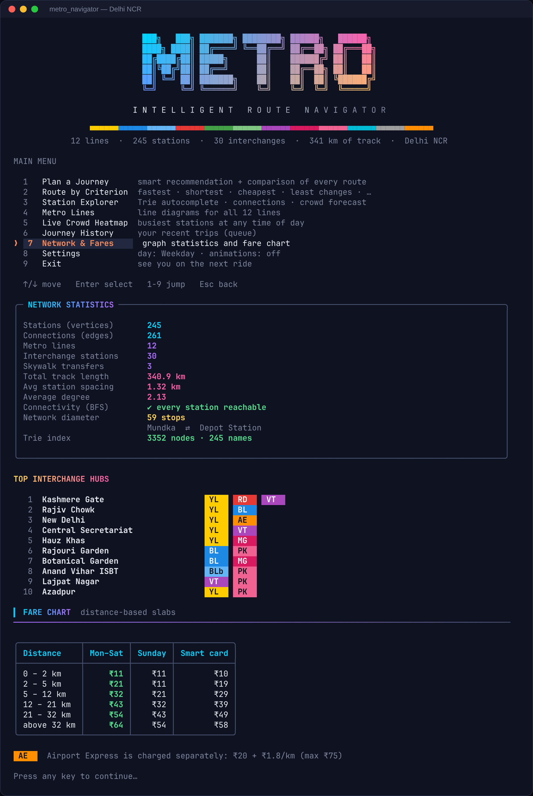
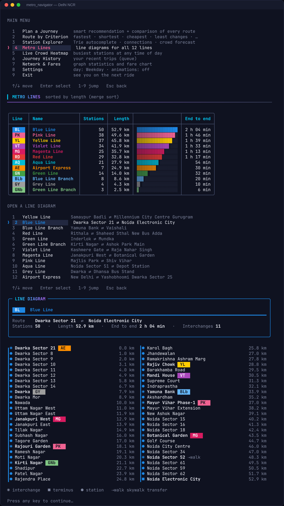
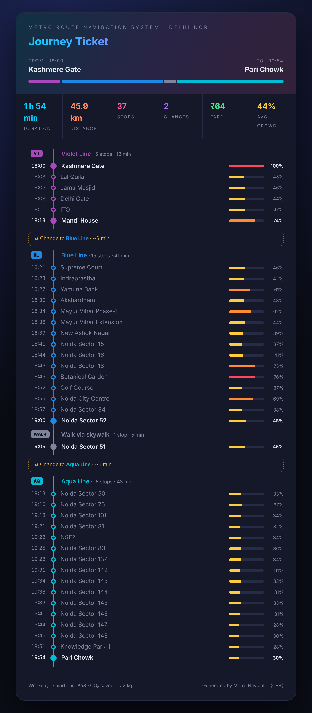

<div align="center">

# 🚇 Metro Route Navigation System

### An intelligent, multi-criteria journey planner for the Delhi NCR Metro, written in modern C++17




</div>

---

## 📖 About the project

> **Jaypee Institute of Information Technology, Noida**<br>
> B.Tech Semester V · *Data Structures and Algorithms Design Lab (25B17CI578)* · Project Based Learning
>
> **Submitted to:** Dr. Arpita Jadhav Bhatt
>
> | Name | Enrolment No. |
> |---|---|
> | Suchismita Chaterjee | 2401020063 |
> | Abhimanyu Sharma | 2401020068 |
> | Nupur Bubna | 2401020073 |
> | Aarushi Singh | 2401020075 |

Navigating a large metro network is hard when there are many possible routes. The route with the shortest distance is not always the fastest, and a slightly longer route may have fewer interchanges, a lower fare, or less crowding during peak hours.

This project models the **entire Delhi NCR metro (12 lines, 245 stations, 30 interchanges, 341 km of track)** as a weighted graph. It runs several graph algorithms side by side, so it can **compare every sensible route and recommend the best one for you**, and it explains why it chose that route.

Everything runs in the terminal. The interface uses 24-bit colour, gradients, line-coloured route ribbons, live autocomplete, arrow-key menus, crowd heat-bars and charts. The program has **no external dependencies**: it uses only the C++ standard library.

---

## ✨ Features

| | Feature | What it does |
|---|---|---|
| 🧠 | **Smart recommendation** | Runs 5 × Dijkstra, 1 × BFS and an alternative-route search. It then de-duplicates the routes, scores each one against your priority and ranks them with a min-heap |
| ⚡ | **Fastest route** | Dijkstra on travel time, including a realistic 6-minute penalty for each line change |
| 📏 | **Shortest route** | Dijkstra on track distance (km) |
| 🔁 | **Least-interchange route** | Dijkstra where every line change costs 1000, so fewer changes always win |
| 💰 | **Cheapest route** | Dijkstra on fare weights. Fares use DMRC-style distance slabs, and the Airport Express has a premium fare |
| 🧍 | **Least-crowded route** | Dijkstra on travel time × the crowd predicted *at the moment you reach each station* |
| 🔢 | **Fewest stops** | Breadth-first search, then a small dynamic program that picks the train lines with the fewest changes |
| 🔀 | **Alternative routes** | An edge-penalty method that finds genuinely different corridors |
| 📈 | **Peak-hour crowd prediction** | Hourly weekday/Sunday demand profiles × station popularity, shown as heat bars and a 24-hour chart |
| 🔎 | **Live autocomplete** | A Trie that matches *any word* of a name: `sector 6` → *Noida Sector 62*, `chowk` → *Rajiv Chowk*, … |
| 🩹 | **Typo tolerance** | Levenshtein edit distance ("did you mean …?") plus a hash-map lookup that ignores case and punctuation |
| 🗺️ | **Line diagrams** | Every line drawn station by station, with interchanges, termini and distances |
| 🔥 | **Crowd heatmap** | The busiest stations at any time of day, sorted with merge sort |
| 🕘 | **Journey history** | The last 10 journeys, kept in a circular FIFO queue and saved to disk |
| 🎫 | **HTML ticket export** | Save any route as a shareable, dark-themed web page |
| 📊 | **Network statistics** | Vertices, edges, BFS connectivity check, network diameter and top hubs |

### DSA concepts used (as proposed in the project synopsis)

| Requirement | DSA concept | Where in the code |
|---|---|---|
| Metro network | **Graph** | [`MetroGraph`](include/metro/MetroGraph.h) |
| Network representation | **Adjacency list** | `MetroGraph::adj_` |
| Fastest / shortest route | **Dijkstra's algorithm** | `RouteFinder::dijkstra` |
| Station-based traversal | **BFS** | `RouteFinder::fewestStops`, `MetroGraph::bfsHops` |
| Least-interchange route | **Weighted graph + Dijkstra** on (station, line) states | `RouteFinder::edgeCost` |
| Route selection | **Priority queue / min-heap**, hand-written | [`MinHeap.h`](include/metro/MinHeap.h) |
| Station lookup | **Hash map** | `MetroGraph::index_` (`std::unordered_map`) |
| Station autocomplete | **Trie** | [`Trie`](include/metro/Trie.h) |
| Route history | **Queue** (circular buffer) | [`BoundedQueue.h`](include/metro/BoundedQueue.h) |
| Sorting routes/stations | **Merge sort**, hand-written and stable | [`Sorting.h`](include/metro/Sorting.h) |
| Crowd-based evaluation | **Weighted graph** with time-dependent weights | `CrowdModel` + `RouteFinder` |
| Alternative comparison | **Priority queue + graph algorithms** | `RouteFinder::alternatives`, `Recommender` |
| Line assignment for BFS paths | **Dynamic programming** | `RouteFinder::assignLines` |
| Typo correction | **Edit distance (DP)** | `str::levenshtein` |

📘 **The whole codebase is documented function by function in [`docs/CODE_DOCUMENTATION.md`](docs/CODE_DOCUMENTATION.md).**

---

## 🖼️ Screenshots

<table>
<tr>
<td width="50%"><b>Main menu + live Trie autocomplete</b><br></td>
<td width="50%"><b>Station explorer + 24-hour crowd forecast</b><br></td>
</tr>
<tr>
<td><b>Live crowd heatmap (09:00, weekday)</b><br></td>
<td><b>Network statistics & fare chart</b><br></td>
</tr>
<tr>
<td><b>Line diagram (Blue Line)</b><br></td>
<td><b>Exported HTML journey ticket</b><br></td>
</tr>
</table>

---

## 🚀 Running it on your computer

You need **a C++17 compiler** and, optionally, **CMake ≥ 3.14**. Nothing else needs to be installed.

### 1. Get the code

```bash
git clone https://github.com/hrideshsrivastava/nupur-project-.git
cd nupur-project-
```

(Or download the ZIP from GitHub and extract it.)

### 2. Build and run on your platform

<details open>
<summary><b>🐧 Linux (Ubuntu / Debian / Fedora / Arch …)</b></summary>

Install a compiler and CMake if you do not have them:

```bash
# Ubuntu / Debian
sudo apt update && sudo apt install -y g++ cmake make
# Fedora
sudo dnf install -y gcc-c++ cmake make
# Arch
sudo pacman -S --needed gcc cmake make
```

Build with **CMake** (recommended):

```bash
cmake -S . -B build -DCMAKE_BUILD_TYPE=Release
cmake --build build -j
./build/metro_navigator
```

…or with the plain **Makefile**:

```bash
make            # builds build/metro_navigator and build/metro_tests
make run        # builds and starts the app
```

</details>

<details>
<summary><b>🍎 macOS</b></summary>

Install Apple's command-line tools (they include `clang++` and `make`), plus CMake through Homebrew:

```bash
xcode-select --install
brew install cmake          # optional; you can use `make` instead
```

Then build and run:

```bash
cmake -S . -B build -DCMAKE_BUILD_TYPE=Release
cmake --build build -j
./build/metro_navigator
```

> 💡 The built-in **Terminal.app** only shows 256 colours, and the app detects this automatically. For the full 24-bit gradients, use **iTerm2**, **WezTerm**, **Kitty**, **Alacritty** or the **VS Code** terminal.

</details>

<details>
<summary><b>🪟 Windows 10 / 11</b></summary>

Use **Windows Terminal** (pre-installed on Windows 11; on Windows 10, get it from the Microsoft Store). It shows the colours and Unicode characters correctly.

**Option A: Visual Studio 2019/2022** (install the *Desktop development with C++* workload, which includes CMake). Open a *Developer PowerShell for VS* and run:

```powershell
cmake -S . -B build
cmake --build build --config Release
.\build\Release\metro_navigator.exe
```

> You can also choose **File → Open → Folder…** in Visual Studio, select the project folder, and press **▶ metro_navigator.exe**.

**Option B: MSYS2 / MinGW-w64.** Install [MSYS2](https://www.msys2.org/), open the *UCRT64* shell and run:

```bash
pacman -S --needed mingw-w64-ucrt-x86_64-gcc mingw-w64-ucrt-x86_64-cmake make
cmake -S . -B build -G "MinGW Makefiles" -DCMAKE_BUILD_TYPE=Release
cmake --build build -j
./build/metro_navigator.exe
```

**Option C: just g++ (no CMake)**

```powershell
g++ -std=c++17 -O2 -Iinclude src/*.cpp -o metro_navigator.exe
.\metro_navigator.exe
```

The program switches the console to UTF-8 and turns on ANSI colour support by itself.

</details>

<details>
<summary><b>🧩 VS Code / CLion / Code::Blocks</b></summary>

* **VS Code:** install the *C/C++* and *CMake Tools* extensions, open the folder, choose a kit, then click **Build** and **▶ Run** in the status bar. Run the app in the integrated terminal.
* **CLion:** open the folder; it detects `CMakeLists.txt` automatically. Select the `metro_navigator` configuration and press Run. *Tip:* enable **Run → Edit Configurations → Emulate terminal in the output console** so the arrow-key menus work.
* **Code::Blocks / Dev-C++:** create an empty project, add every file from `src/`, add `include/` to the compiler's search directories, and set the standard to C++17.

</details>

### 3. Run the tests (optional)

```bash
ctest --test-dir build --output-on-failure   # with CMake
# or
./build/metro_tests                           # direct
make test                                     # with the Makefile
```

The suite checks every data structure and algorithm, including that each criterion is optimal for its own metric, plus the edge cases and history persistence. It runs **116 checks**.

---

## 🎮 How to use it

### Interactive mode

```bash
./build/metro_navigator
```

| Key | Action |
|---|---|
| `↑` `↓` (or `j` `k`) | Move through menus and suggestions |
| `Enter` | Select / confirm |
| `1`–`9` | Jump straight to a menu item |
| `Tab` | Autocomplete the highlighted station |
| `Esc` / `q` | Go back / cancel |

A typical session:

1. **Plan a Journey**
2. Type `rajiv` and press `Enter`. The app suggests *Rajiv Chowk* as you type.
3. Type `sector 62` and press `Enter`.
4. Choose a departure time, for example **Morning peak**.
5. Choose what matters most: **Balanced**, **In a hurry**, **On a budget**, **Comfort first** or **Keep it simple**.
6. The app shows the recommended route card, the reasons for the recommendation, a station-by-station timeline with crowd predictions, and a comparison table of every option.
7. Optionally view the other options or **export an HTML ticket**.

### One-shot command-line mode

```bash
./build/metro_navigator --from "Rajiv Chowk" --to "Noida Sector 62" --time 09:00
./build/metro_navigator --from kashmere --to "pari chowk" --time 18:00 --pref comfort
./build/metro_navigator --from "dwarka sec 21" --to "botanical" --sunday --pref budget
```

| Option | Meaning |
|---|---|
| `--from <name>` / `--to <name>` | Stations. Partial names and small typos are accepted |
| `--time HH:MM` | Departure time (default: now) |
| `--pref <p>` | `balanced`, `fast`, `budget`, `comfort`, `simple` |
| `--sunday` | Sunday/holiday fares and crowd profile |
| `--no-color` / `--truecolor` | Force plain output / force 24-bit colour |
| `--no-anim` | Disable animations |
| `--history <file>` | Where journey history is stored (default `metro_history.txt`) |
| `-h`, `--help` | Show help |

---

## 🗂️ Project structure

```
nupur-project-/
├── CMakeLists.txt            # CMake build (app + tests)
├── Makefile                  # alternative build without CMake
├── include/metro/            # headers — one per component
│   ├── Types.h               #   enums, constants, RGB
│   ├── Station.h             #   Station / Edge / MetroLine structs
│   ├── MetroGraph.h          #   graph: adjacency list + hash-map index
│   ├── MetroData.h           #   built-in Delhi NCR network
│   ├── MinHeap.h             #   hand-written binary heap (priority queue)
│   ├── BoundedQueue.h        #   circular FIFO queue
│   ├── Sorting.h             #   stable merge sort
│   ├── Trie.h                #   autocomplete prefix tree
│   ├── StringUtil.h          #   normalisation, Levenshtein, time formatting
│   ├── CrowdModel.h          #   peak-hour crowd prediction
│   ├── FareCalculator.h      #   slab-based fares
│   ├── Route.h               #   computed journey + segments
│   ├── RouteFinder.h         #   Dijkstra, BFS, alternatives
│   ├── Recommender.h         #   scoring, ranking, explanations
│   ├── JourneyHistory.h      #   persisted history (queue)
│   ├── Terminal.h            #   colours, raw keys, cross-platform console
│   ├── UI.h                  #   panels, tables, meters, menus
│   ├── Renderer.h            #   all screens and visualisations
│   ├── Exporter.h            #   HTML ticket export
│   └── App.h                 #   the interactive application
├── src/                      # implementations (*.cpp) + main.cpp
├── tests/test_main.cpp       # dependency-free test suite
└── docs/
    ├── CODE_DOCUMENTATION.md # function-by-function documentation
    └── screenshots/
```

---

## 🛠️ Troubleshooting

| Problem | Fix |
|---|---|
| Boxes or question marks instead of lines and blocks | Use a modern terminal (Windows Terminal, iTerm2, GNOME Terminal …) with a font such as *Cascadia Mono*, *JetBrains Mono* or *DejaVu Sans Mono*. On the old Windows console, run `chcp 65001` first. |
| Colours look wrong or washed out | Your terminal may not report 24-bit colour support. Try `--truecolor`. If the colours get worse, your terminal only supports 256 colours, which the app uses by default. |
| Arrow keys do nothing in my IDE | Some IDE "run" consoles are not real terminals. Run the program from a terminal, or enable terminal emulation (CLion). The app falls back to typed numeric menus when it is not attached to a terminal. |
| `cmake: command not found` | Install CMake, or use `make` / the single `g++` command shown above. |
| `error: ‘optional’ is not a member of ‘std’` | Your compiler defaults to an older standard. Make sure you pass `-std=c++17` (GCC ≥ 8, Clang ≥ 7, MSVC 2019+). |
| I want to reset my history | Delete `metro_history.txt`, or use *Journey History → Clear history*. |

---

## 📌 Notes on the data

The station lists and line order follow the real Delhi Metro network, with interchanges and skywalk links (*Noida Sector 52 ⇄ 51*, *Dhaula Kuan ⇄ Durgabai Deshmukh South Campus*, *Punjabi Bagh ⇄ Punjabi Bagh West*). The distances between stations, line speeds, fares and crowd profiles are **realistic approximations for educational purposes**. They are not official DMRC data. The whole network lives in one file, [`src/MetroData.cpp`](src/MetroData.cpp), so it is easy to extend or to swap for another city.

<div align="center">

---

Made with ❤️ and lots of `std::vector` for the DSA Lab at **JIIT Noida**

</div>
