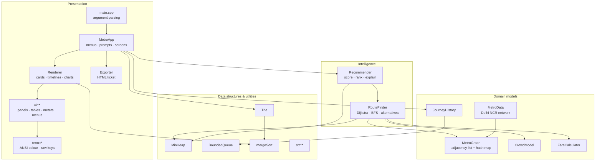
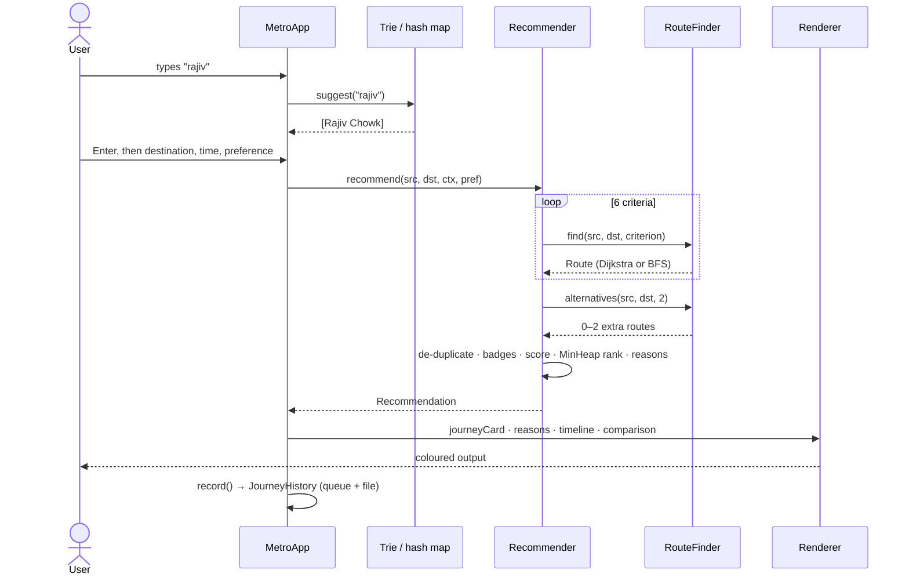

# 📘 Metro Route Navigation System: Code Documentation

This document explains the whole codebase **file by file and function by function**. It starts with the big picture: the architecture, how data flows, and the key algorithmic ideas. After that comes a reference for every component.

> **Conventions.** All code lives in the `metro` namespace. Headers are in `include/metro/` and implementations in `src/`. Station ids and line indices are plain `int`s that index into vectors. `-1` means "none / not found", and as a *line* index it means "walking transfer". Times are in **minutes** and distances in **kilometres**.

---

## Table of contents

1. [Architecture overview](#1-architecture-overview)
2. [How a journey is computed (end-to-end flow)](#2-how-a-journey-is-computed-end-to-end-flow)
3. [Key algorithmic ideas](#3-key-algorithmic-ideas)
4. [Complexity summary](#4-complexity-summary)
5. [File reference](#5-file-reference)
   - [5.1 `Types.h`](#51-typesh--shared-types-and-constants)
   - [5.2 `Station.h`](#52-stationh--vertices-edges-and-lines)
   - [5.3 `MinHeap.h`](#53-minheaph--binary-min-heap)
   - [5.4 `BoundedQueue.h`](#54-boundedqueueh--circular-fifo-queue)
   - [5.5 `Sorting.h`](#55-sortingh--merge-sort)
   - [5.6 `StringUtil.h / .cpp`](#56-stringutilh--stringutilcpp--text-helpers)
   - [5.7 `Trie.h / .cpp`](#57-trieh--triecpp--autocomplete)
   - [5.8 `MetroGraph.h / .cpp`](#58-metrographh--metrographcpp--the-graph)
   - [5.9 `MetroData.h / .cpp`](#59-metrodatah--metrodatacpp--the-delhi-ncr-network)
   - [5.10 `CrowdModel.h / .cpp`](#510-crowdmodelh--crowdmodelcpp--crowd-prediction)
   - [5.11 `Route.h / .cpp`](#511-routeh--routecpp--a-computed-journey)
   - [5.12 `FareCalculator.h / .cpp`](#512-farecalculatorh--farecalculatorcpp--fares)
   - [5.13 `RouteFinder.h / .cpp`](#513-routefinderh--routefindercpp--path-finding-engine)
   - [5.14 `Recommender.h / .cpp`](#514-recommenderh--recommendercpp--intelligent-recommendation)
   - [5.15 `JourneyHistory.h / .cpp`](#515-journeyhistoryh--journeyhistorycpp--history)
   - [5.16 `Terminal.h / .cpp`](#516-terminalh--terminalcpp--console-layer)
   - [5.17 `UI.h / .cpp`](#517-uih--uicpp--visual-building-blocks)
   - [5.18 `Renderer.h / .cpp`](#518-rendererh--renderercpp--screens)
   - [5.19 `Exporter.h / .cpp`](#519-exporterh--exportercpp--html-ticket)
   - [5.20 `App.h / .cpp`](#520-apph--appcpp--the-application)
   - [5.21 `main.cpp`](#521-maincpp--entry-point)
   - [5.22 `tests/test_main.cpp`](#522-teststest_maincpp--test-suite)
6. [Build files](#6-build-files)
7. [Extending the project](#7-extending-the-project)

---

## 1. Architecture overview

The code is split into **four layers**. Each layer depends only on the layers below it.



| Layer | Responsibility | Files |
|---|---|---|
| **Data structures & utilities** | Generic, reusable building blocks written by hand for the DSA lab | `MinHeap.h`, `BoundedQueue.h`, `Sorting.h`, `Trie.*`, `StringUtil.*` |
| **Domain models** | The metro network and the rules about it (fares, crowds, history) | `Station.h`, `MetroGraph.*`, `MetroData.*`, `CrowdModel.*`, `FareCalculator.*`, `Route.*`, `JourneyHistory.*` |
| **Intelligence** | Finding, comparing and recommending routes | `RouteFinder.*`, `Recommender.*` |
| **Presentation** | Everything the user sees and types | `Terminal.*`, `UI.*`, `Renderer.*`, `Exporter.*`, `App.*`, `main.cpp` |

`metro_core` (a static library) contains every `.cpp` except `main.cpp`. Both the app (`metro_navigator`) and the tests (`metro_tests`) link against it.

---

## 2. How a journey is computed (end-to-end flow)



1. **Input**: `MetroApp::askStation` reads the station name. The interactive version suggests stations live from the **Trie** as the user types. Typed text is resolved through the **hash map**, then the Trie, then word-prefix matching, then **Levenshtein** distance (`resolveStation`).
2. **Search**: `Recommender::recommend` calls `RouteFinder::find` once for each `Criterion`. Five of these are **Dijkstra** runs with different edge costs. *Fewest stops* is a **BFS**. It then asks for alternative corridors.
3. **Annotation**: every raw path goes through `RouteFinder::buildRoute`. This splits the path into line *segments* and computes arrival times, interchanges, distance, fare (`FareCalculator`) and the crowd predicted at each station (`CrowdModel`).
4. **Ranking**: identical paths are merged. Each remaining route gets badges and a weighted score, and the routes are popped from a **min-heap** in rank order. The recommender also writes human-readable reasons for its choice.
5. **Output**: `Renderer` draws the result, `JourneyHistory` stores it in a **queue** and on disk, and `exportJourneyHtml` can save it as a web page.

---

## 3. Key algorithmic ideas

### 3.1 The graph

* **Vertices** are stations (`Station`). **Edges** (`Edge`) join consecutive stations on a line and store the line, distance and travel time.
* The graph is **undirected**: every connection is stored as two directed edges, a→b and b→a.
* It is stored as an **adjacency list**, `std::vector<std::vector<Edge>> adj_`. Metro networks are very sparse (average degree ≈ 2.1), so an adjacency matrix of 245×245 would be more than 99% empty.
* The time on an edge is `distance / lineSpeed × 60 + kDwellMin`, which adds 0.5 min of halt time at each station.
* **Skywalks** are edges with `line = -1`. They connect stations with different names that are linked on foot.

### 3.2 Line-aware Dijkstra (the expanded state space)

Plain Dijkstra on stations *cannot* charge for changing lines. When it reaches Rajiv Chowk, it does not remember whether it arrived on the Yellow or the Blue line. The fix is to run Dijkstra on **states**:

```
state = (station, line I arrived on)        encoded as  station * (L + 1) + (line + 1)
```

Slot `0` means "not on a train yet". When the algorithm relaxes an edge on line ℓ′ from a state on line ℓ:

* if `ℓ ≠ ℓ′` (and ℓ is a real line) → it is a **line change**: add `kTransferPenaltyMin` (6 min) to the time, and count one interchange;
* walking edges keep ℓ ("the last train I rode"), so the *next* boarding still counts as a change.

The state space has `245 × 13 ≈ 3,200` vertices, which is still tiny. Because the change penalty is now part of an ordinary edge weight, Dijkstra's optimality guarantee still holds.

### 3.3 One Dijkstra, many criteria

The search code is the same for every criterion. Only `edgeCost` changes:

| Criterion | Edge cost |
|---|---|
| Fastest | `time (+6 if line change)` |
| Shortest | `km + 0.001·time` (time only breaks ties) |
| Least interchange | `1000·[change] + time` (lexicographic: changes first, then time) |
| Cheapest | `km·(premium ? 3 : 1) + 12·[boarding premium line] + 0.001·time` |
| Least crowded | `time · (1 + 2.5·c²)`, where `c` is the crowd at the next station *when you arrive there* |
| Fewest stops | handled by BFS instead of Dijkstra |

### 3.4 Alternatives by the edge-penalty method

After the fastest route is found, every station pair on it has its cost multiplied by **1.8** and Dijkstra runs again. The new search is pushed onto a different corridor. This repeats, and the result is kept whenever it is a new path and not absurdly slow (≤ 1.5 × best + 20 min).

### 3.5 Scoring and recommendation

For each candidate route *r* and metric *m* ∈ {time, interchanges, fare, crowd, distance}:

```
norm_m(r) = (m(r) − min_m) / (max_m − min_m)          (0 = best, 1 = worst)
score(r)  = Σ w_m · norm_m(r)                           (weights depend on Preference)
match(r)  = round(100 · (1 − score(r)))
```

The routes are pushed into a `MinHeap` keyed on score (ties go to the faster route) and popped out in rank order.

### 3.6 Trie autocomplete over every word

Each name is inserted **once per word boundary**. For example, "Noida Sector 62" is inserted as `noida sector 62`, `sector 62` and `62`. A prefix walk followed by a DFS therefore finds matches anywhere in the name. Each entry keeps its word position (`rank`), so stations whose *full name* starts with the prefix are listed first.

### 3.7 Crowd prediction

```
crowd(s, t) = clamp( (0.22 + 0.78·footfall(s)/10) · demand(t) · 100  +  jitter(s, hour) · demand(t),  0, 100 )
```

`demand(t)` interpolates linearly between 24 hourly values, with separate weekday and Sunday profiles. `footfall` (1–10) is the station's popularity. `jitter` is a deterministic hash in the range ±4%, so stations with equal popularity do not look identical.

---

## 4. Complexity summary

Notation: **V** = stations (245), **E** = connections (261), **L** = lines (12), **S** = V·(L+1) states, **k** = key length.

| Operation | Time | Space |
|---|---|---|
| Station lookup (`findStation`, hash map) | O(k) average | O(V) |
| Trie insert (one name, all word suffixes) | O(k²) | O(k²) nodes |
| Trie suggest | O(k + matches·log matches) | O(matches) |
| `MinHeap` push / pop | O(log n) | O(n) |
| `BoundedQueue` enqueue / dequeue | O(1) | O(capacity) |
| `mergeSort` | O(n log n) | O(n) |
| BFS (`bfsHops`, `fewestStops`) | O(V + E) | O(V) |
| Line-aware Dijkstra | O((S + E·L) log S) | O(S) |
| `assignLines` (DP) | O(hops · L · deg) | O(hops · L) |
| Alternatives (penalty method, k routes) | O(k · Dijkstra) | O(S) |
| Full recommendation | 6 searches + alternatives, **≈ 0.3 ms** in practice | — |
| Levenshtein | O(\|a\|·\|b\|) | O(\|b\|) |
| Network diameter (`networkStats`) | O(V·(V + E)) | O(V) |

---

## 5. File reference

### 5.1 `Types.h`: shared types and constants

| Item | Description |
|---|---|
| `struct RGB { r, g, b }` | A 24-bit colour. Every line has one, and the UI builds gradients from it. |
| `kTransferPenaltyMin = 6.0` | Minutes added for each line change (platform walk plus average wait). |
| `kDwellMin = 0.5` | Halt time added to every edge. |
| `kMinutesPerDay = 1440` | Used to wrap clock arithmetic. |
| `enum class Criterion` | `Fastest, Shortest, LeastInterchange, Cheapest, LeastCrowded, FewestStops`: what a single search optimises. |
| `enum class Preference` | `Balanced, Hurry, Budget, Comfort, Simple`: the user's overall priority, which sets the recommender's weights. |
| `enum class DayType` | `Weekday, Sunday`: selects the fare table and the crowd profile. |

**Functions** (all `inline`, all pure lookups):

| Function | Returns |
|---|---|
| `criterionName(Criterion)` | Display name, e.g. `"Least Interchange"`. |
| `criterionAlgorithm(Criterion)` | One-line description of the algorithm and weight used, shown in menus. |
| `preferenceName(Preference)` | Display name, e.g. `"In a hurry"`. |
| `preferenceTagline(Preference)` | Short explanation shown next to the name in the preference menu. |
| `dayTypeName(DayType)` | `"Weekday"` or `"Sunday / Holiday"`. |

---

### 5.2 `Station.h`: vertices, edges and lines

| Struct | Fields | Notes |
|---|---|---|
| `MetroLine` | `code`, `name`, `color`, `speedKmph`, `premium`, `stations` (ids in running order), `lengthKm` | `lengthKm` is accumulated by `MetroGraph::addConnection`. |
| `Edge` | `to`, `line`, `distanceKm`, `timeMin` | One *directed* adjacency-list entry. |
| `Station` | `id`, `name`, `lines`, `footfall`, `hasWalkLink` | `lines` lists every line serving the station. |

| Function | Description |
|---|---|
| `bool Edge::isWalk() const` | `true` when `line < 0`, i.e. the edge is a pedestrian skywalk and not track. |
| `bool Station::isInterchange() const` | `true` if more than one line serves the station *or* it has a skywalk link. |

---

### 5.3 `MinHeap.h`: binary min-heap

A header-only template `MinHeap<T, Compare>` stored as an implicit binary tree in a `std::vector` (the parent of *i* is `(i−1)/2`, and its children are `2i+1` and `2i+2`). `Compare(a, b)` returns `true` when `a` must leave the heap first. It is used by **Dijkstra** (the frontier) and by the **Recommender** (ranking).

| Function | Description | Complexity |
|---|---|---|
| `explicit MinHeap(Compare cmp = Compare())` | Stores the comparator (a lambda can be passed). | O(1) |
| `void push(T value)` | Appends to the vector, then `siftUp` restores the heap property. | O(log n) |
| `const T& top() const` | Returns the root (best element). Throws `std::out_of_range` if the heap is empty. | O(1) |
| `T pop()` | Moves the root out, moves the last element to the root, then calls `siftDown`. With a single element it just pops it, which avoids a self-move. Throws if empty. | O(log n) |
| `bool empty() const` / `size()` / `clear()` | Standard accessors. | O(1) |
| `void siftUp(i)` *(private)* | Swaps element *i* with its parent while it beats the parent. | O(log n) |
| `void siftDown(i)` *(private)* | Swaps element *i* with its best child while that child beats it. | O(log n) |

---

### 5.4 `BoundedQueue.h`: circular FIFO queue

A header-only template `BoundedQueue<T>` with a fixed capacity, built on a ring buffer. `head_` is the index of the oldest element and `count_` is the number of stored elements. It holds the **journey history**.

| Function | Description | Complexity |
|---|---|---|
| `explicit BoundedQueue(capacity)` | Allocates the buffer. A capacity of 0 becomes 1. | O(capacity) |
| `bool enqueue(const T&)` | Writes at `(head + count) % cap`. **If the queue is full, it first drops the oldest element** by advancing `head`. Returns `true` when an element was evicted. | O(1) |
| `T dequeue()` | Removes and returns the oldest element. Throws if empty. | O(1) |
| `front()` / `back()` | Oldest / newest element. | O(1) |
| `const T& at(i) const` | The i-th element counted from the oldest. Throws `std::out_of_range` if `i ≥ size()`. | O(1) |
| `size()`, `capacity()`, `empty()`, `full()`, `clear()` | Standard accessors; `clear` just resets the indices. | O(1) |

---

### 5.5 `Sorting.h`: merge sort

| Function | Description |
|---|---|
| `template mergeSort(std::vector<T>& v, Compare cmp)` | Sorts `v` in place. It allocates one scratch buffer (a copy of `v`) and calls the recursive helper. Vectors of size < 2 return immediately. |
| `detail::mergeSortRange(v, buf, lo, hi, cmp)` | Top-down recursion: sorts `[lo, mid)` and `[mid, hi)`, then merges them into `buf` and copies back. It takes from the right half **only when strictly smaller**, which makes the sort **stable**. |

It is used to rank Trie matches, sort stations by crowd level (heatmap), sort lines by length, sort hubs, and sort fuzzy matches. **O(n log n)** time, **O(n)** extra space.

---

### 5.6 `StringUtil.h / .cpp`: text helpers

Namespace `metro::str`.

| Function | Description |
|---|---|
| `std::string toLower(std::string s)` | Returns a lower-cased ASCII copy. |
| `std::string trim(const std::string& s)` | Removes leading and trailing whitespace. |
| `std::string normalizeKey(const std::string& s)` | **Hash-map key**: keeps only letters and digits, lower-cased. `"Dilli Haat - INA"` → `"dillihaatina"`. As a result, `"rajiv   CHOWK"` finds *Rajiv Chowk*. |
| `std::string normalizeWords(const std::string& s)` | **Trie key**: lower-case words separated by single spaces. Punctuation counts as a separator. A trailing space in the input is kept, so that `"noida "` (still typing) is not treated the same as `"noida"`. |
| `std::vector<std::string> split(s, delimiter)` | Splits on one character and keeps empty fields. Used for history lines (`|`) and word lists. |
| `std::size_t levenshtein(a, b)` | Edit distance (insert, delete and substitute each cost 1), computed with **two-row dynamic programming**: O(\|a\|·\|b\|) time, O(\|b\|) memory. Powers "did you mean…?" and typo correction. |
| `std::string formatDuration(double minutes)` | `42` → `"42 min"`, `75` → `"1 h 15 min"`. |
| `std::string formatClock(double minuteOfDay)` | Minutes → `"HH:MM"`, wrapping around midnight (also for negative values). |
| `bool parseClock(text, int& minuteOfDay)` | Accepts `"9"`, `"09:30"`, `"9.30"`, `"930"` and `"1830"`. Rejects non-digits, hours > 23 and minutes > 59. Returns `false` on bad input. |
| `std::string fixed(double value, int precision)` | Fixed-point formatting, e.g. `fixed(3.14159, 1)` → `"3.1"`. |

---

### 5.7 `Trie.h / .cpp`: autocomplete

```
root ─ n ─ o ─ i ─ d ─ a ─ ␠ ─ s ─ e ─ c ─ … ─ 6 ─ 2  {Noida Sector 62, rank 0}
     └ s ─ e ─ c ─ t ─ o ─ r ─ ␠ ─ 6 ─ 2                {Noida Sector 62, rank 1}
     └ 6 ─ 2                                            {Noida Sector 62, rank 2}
```

Each `Node` has `std::map<char, unique_ptr<Node>> children`. The map is *ordered*, so the DFS visits matches alphabetically. Each node also has a vector of `Entry {id, rank, display}` for the keys that end at that node.

| Function | Description |
|---|---|
| `Trie()` / `~Trie()` | Creates the root. Destruction is automatic because of `unique_ptr`. Copying is disabled. |
| `void insert(const std::string& name, int id)` | Normalises the name with `normalizeWords`, then calls `insertKey` once for **every suffix that starts at a word boundary**. The `rank` is the word index: 0 for the full name. |
| `void insertKey(key, entry)` *(private)* | Walks or creates one node per character, then appends the entry at the last node. Counts the nodes created. |
| `const Node* walk(key) const` *(private)* | Follows the characters of `key` from the root. Returns `nullptr` if the path does not exist. |
| `static void collect(node, out, cap)` *(private)* | Pre-order DFS that gathers every entry below `node`. It stops early at `cap` entries (512) to bound the work. |
| `std::vector<int> suggest(prefix, limit) const` | Normalises the prefix, then calls `walk` and `collect`. It sorts with `mergeSort` (full-name matches first, then word position, then alphabetical), removes duplicate station ids with an `unordered_set`, and returns at most `limit` ids. Returns an empty vector for an empty prefix or no match. |
| `bool contains(name) const` | `true` if `name` was inserted as a *complete* name (an entry with rank 0 exists at the end of its path). |
| `nodeCount()` / `wordCount()` | Statistics shown on the Network screen. |

---

### 5.8 `MetroGraph.h / .cpp`: the graph

Private members: `stations_` (vertices), `adj_` (**adjacency list**), `lines_`, `index_` (an `unordered_map<string,int>` **hash map** from the normalised name to the id), and `connections_` (the number of undirected edges).

| Function | Description |
|---|---|
| `int addLine(code, name, color, speedKmph, premium = false)` | Appends a `MetroLine` and returns its index. |
| `int addStation(const std::string& name)` | If a station with the same *normalised* name already exists, returns its id. This is how interchange stations are shared between lines. Otherwise it creates the station, an empty adjacency vector and a hash-map entry. |
| `void addConnection(a, b, line, distanceKm)` | Computes `minutes = km / speed × 60 + kDwellMin`, then pushes the two directed edges `a→b` and `b→a`. It adds the distance to the line's length and increments `connections_`. |
| `void addWalkTransfer(a, b, meters, minutes)` | Looks up both station names, adds two edges with `line = -1`, and marks both stations `hasWalkLink`. Throws `std::invalid_argument` for an unknown name. |
| `void buildLine(line, stops)` | Takes `{name, km from previous}` pairs. For each one it calls `addStation`, records that the line serves the station (no duplicates), appends the station to the line's running order, and connects it to the previous station. |
| `void setFootfall(name, footfall)` | Sets a station's popularity, clamped to 1..10. Throws for an unknown name. |
| `void finalizeFootfall()` | Gives every station still at 0 a default of `3 + 2·(lines − 1) + (skywalk ? 1 : 0)`, clamped to 1..10. Busier interchanges therefore get more crowded automatically. |
| `int findStation(name) const` | **O(1) hash-map lookup** on the normalised key. Returns `-1` if the station is unknown. |
| `int findLine(codeOrName) const` | Linear scan matching the code (`"BL"`) or the name (`"blue line"`). Returns `-1` if nothing matches. |
| `const Edge* edgeBetween(a, b, line) const` | Scans `a`'s adjacency list for the edge to `b` on `line` (`-1` = walk). Returns `nullptr` if there is none. |
| `std::vector<int> bfsHops(source) const` | **Breadth-first search** using `std::queue`. Returns the number of hops from `source` to every station, or `-1` for unreachable ones (or for an invalid source). |
| `bool isConnected() const` | Runs `bfsHops(0)` and checks that no station is unreachable. |
| `std::vector<int> interchangeStations() const` | Ids of all stations where `isInterchange()` is true. |
| `double totalTrackKm() const` | Sum of all line lengths. |
| `station(id)`, `stations()`, `neighbors(id)`, `line(idx)`, `lines()`, `stationCount()`, `lineCount()`, `connectionCount()` | Accessors. They use `.at()` and so throw on a bad index. |

---

### 5.9 `MetroData.h / .cpp`: the Delhi NCR network

| Function | Description |
|---|---|
| `MetroGraph data::buildDelhiMetro()` | Builds and returns the complete network. The steps are: (1) register 12 lines with their colours and average speeds; Airport Express is `premium`. (2) Call `buildLine` for each line, listing stations in running order with the distance from the previous station. (3) Add 3 skywalks: *Noida Sector 52⇄51*, *Dhaula Kuan⇄Durgabai Deshmukh South Campus*, *Punjabi Bagh⇄Punjabi Bagh West*. (4) Set the popularity of the busiest known hubs with `setFootfall`. (5) Call `finalizeFootfall` for the rest. |

The lines are Yellow, Blue, Blue Branch, Red, Green, Green Branch, Violet, Magenta, Pink, Aqua, Grey and Airport Express. The branches are modelled as separate lines, because trains really do require a change at Yamuna Bank and Ashok Park Main. To add a line or a city, edit only this file.

---

### 5.10 `CrowdModel.h / .cpp`: crowd prediction

Internal data: `kWeekdayProfile` and `kSundayProfile`, two arrays of 24 values each giving the share of peak ridership at the start of every hour. The weekday profile peaks at 09:00 and 18:00. The Sunday profile is flatter and peaks around midday and early evening.

| Function | Description |
|---|---|
| `wrapMinute(m)` *(file-local)* | Wraps any minute value into `[0, 1440)`; negative values work too. |
| `CrowdModel(const MetroGraph&)` | Stores a reference to the graph, which is needed for each station's footfall. |
| `static double demand(minuteOfDay, DayType)` | Linear interpolation between the profile values for hour *h* and hour *h+1*. Returns 0..1. |
| `double level(station, minuteOfDay, DayType) const` | The formula from [§3.7](#37-crowd-prediction): popularity × demand × 100, plus a deterministic jitter derived from a multiplicative hash of (station, hour). The result is clamped to 0..100. |
| `std::vector<double> forecast(station, DayType) const` | 24 values, each the level at *hh*:30. Feeds the 24-hour bar chart. |
| `static bool isPeak(minuteOfDay, DayType)` | Weekday 08:00–10:30 or 17:00–19:30. Always `false` on Sundays. |
| `static const char* label(level)` | `< 25` → "Low", `< 50` → "Moderate", `< 75` → "High", otherwise "Packed". |

---

### 5.11 `Route.h / .cpp`: a computed journey

| Struct | Fields |
|---|---|
| `Segment` | `line` (`-1` = walk), `stations` (both endpoints included), `distanceKm`, `rideMin`, `transferBeforeMin` (the change penalty paid before boarding). |
| `Route` | `stations`, `hopLines` (one line per hop), `segments`, `etaMin` (minutes after departure, per station), `crowd` (per station), `distanceKm`, `totalMin`, `walkMin`, `interchanges`, `fare`, `smartCardFare`, `avgCrowd`, `peakCrowd`, `peakCrowdStation`, `foundBy` (which criteria produced this route). |

| Function | Description |
|---|---|
| `bool Segment::isWalk() const` | `line < 0`. |
| `int Segment::stops() const` | `stations.size() − 1`. |
| `bool Route::empty() const` | Fewer than 2 stations. |
| `int Route::stops() const` | Number of hops. |
| `std::string Route::signature() const` | A string such as `"12:3>13:3>14"` that encodes both the stations *and* the lines. Two routes are the same journey exactly when their signatures are equal. Used for de-duplication. |
| `double Route::co2SavedKg() const` | `distanceKm × (0.192 − 0.035)`: the CO₂ of a car minus that of the metro, in kg per passenger-km. |

---

### 5.12 `FareCalculator.h / .cpp`: fares

`FareBreakdown` holds `regularKm`, `premiumKm`, `regular`, `premium`, `total` and `smartCard`. `Slab` holds `upToKm`, `weekday` and `sunday`.

| Function | Description |
|---|---|
| `static const std::vector<Slab>& slabs()` | The DMRC-style table: ≤2 km ₹11/11, ≤5 ₹21/11, ≤12 ₹32/21, ≤21 ₹43/32, ≤32 ₹54/43, above that ₹64/54 (weekday/Sunday). Built once as a function-local static. |
| `static int slabFare(km, DayType)` | Fare of the first slab whose `upToKm ≥ km`. Returns 0 for 0 km. |
| `static int premiumFare(km)` | Airport Express: `20 + ceil(km) × 1.8`, capped at ₹75. Returns 0 for 0 km. |
| `static int smartCardFare(fare)` | Fare after the 10% discount, rounded. |
| `static FareBreakdown compute(route, graph, DayType)` | Splits the route's train distance into regular km and premium km (walks are free). Charges `slabFare(regularKm) + premiumFare(premiumKm)`, then applies the smart-card discount. |

---

### 5.13 `RouteFinder.h / .cpp`: path-finding engine

`JourneyContext { departMinute, day }` describes *when* the passenger travels. `EdgePenalties` is an `unordered_map<uint64_t, double>` from a station pair to a cost multiplier.

| Function | Description |
|---|---|
| `RouteFinder(graph, crowd)` | Stores references to the graph and the crowd model. |
| `static uint64_t edgeKey(a, b)` *(private)* | Packs the unordered pair as `min << 32 | max`, so a→b and b→a share one key. |
| `std::optional<Route> find(source, target, criterion, ctx) const` | Dispatcher: `FewestStops` → `fewestStops`, every other criterion → `dijkstra` (without penalties). |
| `double edgeCost(edge, lineChange, boardingPremium, criterion, stepMinutes, clockMinute, day) const` *(private)* | The **criterion-specific weight** from [§3.3](#33-one-dijkstra-many-criteria). `stepMinutes` already includes any transfer penalty. For *LeastCrowded* it asks `CrowdModel::level` for the next station at `clockMinute`, the actual time you reach it, which makes the weights **time-dependent**. |
| `std::optional<Route> dijkstra(source, target, criterion, ctx, penalties) const` *(private)* | **Line-aware Dijkstra** ([§3.2](#32-line-aware-dijkstra-the-expanded-state-space)). <br>• It validates the input: an invalid id or `source == target` returns `nullopt`. <br>• It allocates `best`, `parent` and `arrivedOn` arrays over all states. <br>• The frontier is a `MinHeap<Label>` ordered by cost. A `Label` also carries the real elapsed minutes, which the crowd weight needs. <br>• Each pop skips stale labels (*lazy deletion*) and increments `explored_`. The search stops at the first pop of any state at the target, which is optimal. <br>• Relaxation works out whether the edge is a line change or the start of a premium-line ride, computes the step time and the criterion cost, and multiplies by any penalty for that station pair. <br>• Finally it follows `parent` pointers back, reverses the station and line lists, and calls `buildRoute`. |
| `std::optional<Route> fewestStops(source, target, ctx) const` | **BFS** on stations using a `std::queue`, `seen` and `parent`. The first time the target is dequeued, the path has the fewest hops. It then rebuilds the path, chooses lines with `assignLines`, and calls `buildRoute`. |
| `std::vector<int> assignLines(path) const` *(private)* | BFS returns only stations, but between two stations several lines (or a walk) may be possible. This **dynamic program** runs over hops. Its state is "last train line ridden", its value is (changes so far, previous state, line chosen), and it keeps the minimum number of changes for each state. Backtracking from the best final state gives one line per hop. |
| `std::vector<Route> alternatives(source, target, ctx, count) const` | **Edge-penalty method** ([§3.4](#34-alternatives-by-the-edge-penalty-method)). It finds the fastest route, then repeatedly multiplies the cost of every used station pair by ×1.8 and searches again. A route is kept only if its signature is new and `totalMin ≤ 1.5 × best + 20`. It stops after `count` routes or `4·count` attempts. |
| `Route buildRoute(stations, hopLines, ctx) const` | **Annotates a raw path**. For each hop it looks up the edge and detects line changes: it adds 6 min and counts an interchange, ignoring walks. It starts a new `Segment` whenever the line changes, and accumulates distance, time, walk time and the arrival time (`etaMin`) of each station. Then it computes the fare with `FareCalculator::compute`, the crowd at each station *at its arrival time*, and the average and peak crowd. |
| `const MetroGraph& graph() const` | Exposes the graph (the recommender uses it for station names). |
| `std::size_t lastExplored() const` | The number of states settled by the most recent search, shown to the user as a performance statistic. |

---

### 5.14 `Recommender.h / .cpp`: intelligent recommendation

| Type | Purpose |
|---|---|
| `ScoredRoute` | `route`, `score` (lower is better), `match` (0–100%), `badges`. |
| `Reason` | `positive` (✔ or ▲) and `text`. |
| `Recommendation` | `options` (ranked), `reasons`, `computeMs`, `statesExplored`. |
| `Weights` | `time, interchanges, fare, crowd, distance`. They sum to 1. |

| Function | Description |
|---|---|
| `normalise(value, lo, hi)` *(file-local)* | Min-max scaling to 0..1. Returns 0 when every route has the same value. |
| `Recommender(const RouteFinder&)` | Stores the finder. |
| `static Weights weightsFor(Preference)` | Balanced (.35/.20/.15/.20/.10), Hurry (time .70), Budget (fare .60), Comfort (crowd .50), Simple (interchanges .60). |
| `Recommendation recommend(source, target, ctx, preference) const` | The core pipeline, in four phases. <br>**1. Candidates:** runs `find` for all 6 criteria plus `alternatives(…, 2)`, adding up `lastExplored()`. `addCandidate` merges duplicates by `signature()` and combines their `foundBy` lists. <br>**2. Ranges:** works out the min/max of each metric across the candidates. <br>**3. Score and rank:** computes the weighted normalised score and `match %` for each route, and awards badges to every route that ties for best in a metric (`FASTEST`, `DIRECT`/`FEWEST CHANGES`, `CHEAPEST`, `LEAST CROWDED`, `SHORTEST`, `FEWEST STOPS`). The routes are pushed into a `MinHeap` keyed by score, with time as the tie-break, and popped into `options`. <br>**4. Explain:** builds `reasons` for the winner: the quickest option or how many minutes slower it is, direct or fewest changes, lowest fare, least crowded; plus warnings for a peak crowd ≥ 75% at a named station and for travelling in peak hours. It also measures the wall-clock time with `std::chrono::steady_clock`. |

---

### 5.15 `JourneyHistory.h / .cpp`: history

`JourneyRecord` holds `timestamp`, `from`, `to`, `mode`, `minutes`, `fare` and `interchanges`. File format: one record per line, separated by `|`.

| Function | Description |
|---|---|
| `JourneyHistory(filePath, capacity = 10)` | Stores the path and creates a `BoundedQueue` of that capacity. |
| `void add(const JourneyRecord&)` | `enqueue`s the record (which evicts the oldest if the queue is full), then calls `save()`. |
| `bool load()` | Reads the file line by line, splits each line on `|`, and enqueues every valid 7-field record. Corrupt lines are skipped through `try/catch`. Returns `false` if the file cannot be opened. |
| `bool save() const` | Rewrites the whole file from the queue, oldest record first. |
| `void clear()` | Empties the queue and saves, which truncates the file. |
| `static std::string nowStamp()` | Current local time as `"YYYY-MM-DD HH:MM"`. It uses `localtime_s` on Windows and `localtime_r` elsewhere, both of which are thread-safe. |
| `records()`, `path()` | Accessors. |

---

### 5.16 `Terminal.h / .cpp`: console layer

Namespace `metro::term`. This is the only file with platform-specific code (`#ifdef _WIN32`). Its file-level state is `g_mode` (the colour mode), `g_animations`, and `g_savedTermios` (POSIX only).

| Function | Description |
|---|---|
| `stdoutIsTTY()` / `stdinIsTTY()` *(file-local)* | `isatty` / `_isatty`. |
| `envContains(name, needle)` *(file-local, POSIX)* | Checks whether an environment variable contains a substring. |
| `onInterrupt(int)` *(file-local)* | **Ctrl+C handler**: writes the codes that reset colours and show the cursor, then calls `_Exit(130)`. Without it, the shell would be left with a hidden cursor. |
| `to256(RGB)` *(file-local)* | Maps a 24-bit colour to the xterm 6×6×6 colour cube (`16 + 36r + 6g + b`). |
| `void init()` | **Windows:** sets the console code page to UTF-8 and enables `ENABLE_VIRTUAL_TERMINAL_PROCESSING`, giving TrueColor (or no colour if that fails). **POSIX:** TrueColor if `COLORTERM` contains `truecolor`/`24bit`, otherwise 256 colours; `TERM=dumb` gives no colour. On every platform, `NO_COLOR` or redirected output turns colours off, and redirected output also turns animations off. Finally it installs the SIGINT handler. |
| `colorMode()` / `setColorMode()` | Get or override the mode (`--no-color`, `--truecolor`). |
| `animations()` / `setAnimations()` | Global animation switch. |
| `bool interactive()` | `true` when both stdin and stdout are terminals. Decides between arrow-key widgets and numbered prompts. |
| `int columns()` | Terminal width from `TIOCGWINSZ` / `GetConsoleScreenBufferInfo`, falling back to `$COLUMNS` and then to 100. |
| `fg(RGB)` / `bg(RGB)` | Foreground / background escape codes: `38;2;r;g;b` (TrueColor), `38;5;n` (256 colours) or `""` (no colour). |
| `reset()`, `bold()`, `dim()`, `italic()` | SGR codes, or `""` when colours are off. |
| `clearScreen()`, `hideCursor()`, `showCursor()` | Screen control, written only to a real terminal. |
| `flush()` | Flushes `std::cout`. |
| `sleepMs(ms)` | Flushes and sleeps, but only when animations are on. |
| `RawMode::RawMode()` / `~RawMode()` | **RAII raw mode.** On POSIX it saves the `termios` settings, then turns off `ICANON`, `ECHO`, `ISIG`, `IXON` and `ICRNL` with `VMIN=1`; the destructor restores the saved settings. On Windows it does nothing, because `_getch` is already raw. |
| `byteReady(ms)` *(file-local, POSIX)* | `select()` with a timeout. It tells a bare **Esc** key apart from the start of an escape sequence such as `ESC [ A`. |
| `int readKey()` | Blocks for one key. It decodes the arrows (`ESC [ A–D` on POSIX, `224` + scan code on Windows) and Enter, Backspace, Tab, Esc, Ctrl+C and Ctrl+D/Z into `Key` codes. It swallows sequences it does not know (e.g. Delete = `ESC [ 3 ~`) and returns ordinary characters unchanged. |

---

### 5.17 `UI.h / .cpp`: visual building blocks

Namespace `metro::ui`. `palette::*` defines the app's colours (accent cyan, violet, pink, success, warning, danger, gold, …).

**File-local helpers**

| Function | Description |
|---|---|
| `codePoints(s)` | Splits UTF-8 text into code points (1–4 bytes each) so that gradients and truncation never cut a character in half. |
| `bar(fraction, width, colorAt)` | The shared meter renderer. It draws full `█` cells, then a partial cell with **1/8-block precision** (`▏▎▍▌▋▊▉`), then a `░` track. `colorAt(i)` gives the colour of cell *i*. |

**Public functions**

| Function | Description |
|---|---|
| `int layoutWidth()` | The terminal width minus 4, clamped to 64..104. Panels and rules use this width. |
| `std::size_t visibleWidth(s)` | Printable width: skips ANSI CSI sequences (`ESC [ … final-byte`) and counts only UTF-8 lead bytes. This is essential for aligning coloured text. |
| `pad(s, width, align)` | Pads to a visible width on the left, right or centre. |
| `truncate(s, width)` | Cuts plain text to `width` columns and ends it with `…`. |
| `repeat(s, n)` | Repeats a (possibly multi-byte) string. |
| `RGB lerp(a, b, t)` | Linear interpolation between two colours, used for every gradient. |
| `paint(text, color, bold)` | Wraps text in a colour (and bold). Returns the plain text when colours are off. |
| `muted(text)` / `strong(text)` | Shorthands for the grey style and the bold-white style. |
| `gradient(text, from, to, bold)` | Gives each code point its own colour along `from → to`; spaces stay uncoloured. Used for the banner, titles and rules. |
| `RGB crowdColor(level)` | A piecewise colour scale: green → yellow (45) → orange (72) → red (100). |
| `badge(text, background, foreground)` | Bold text on a coloured background, or `[text]` without colours. |
| `meter(fraction, width, from, to)` | A bar with a gradient from left to right. |
| `crowdMeter(level, width)` | A bar whose cells follow the crowd heat scale. |
| `heading(title, subtitle)` | Section header: an accent bar, a gradient title, a muted subtitle and a full-width gradient rule. |
| `panel(title, lines, border, width)` | A rounded box (`╭─╮│╰╯`) with the title set into the top border. Each line is padded to the inner width. |
| `rule(color)` | A horizontal line. |
| `success / warn / error / info(message)` | Status lines with ✔ ▲ ✖ ● icons. |
| `spinner(message, durationMs)` | An animated braille spinner (`⠋⠙⠹…`) whose colour shifts between accent colours, followed by a clean line clear. It is skipped when animations are off. |
| `std::optional<std::string> prompt(label)` | A styled prompt read with `std::getline`. Returns the trimmed input, or `nullopt` at **end of input**, which lets piped runs finish cleanly. |
| `pressEnter()` | "Press any key to continue…" (raw single key). Does nothing when not interactive. |
| `drawBlock(lines)` | **In-place redraw**: prints each line after `\r\x1b[2K` (clear line), then moves the cursor back up to the block's first line. Menus and autocomplete redraw themselves with this on every key press. |
| `endBlock(lineCount)` | Moves the cursor below a drawn block. |
| `int menu(title, items, initial)` | **Interactive mode**: hides the cursor, enters `RawMode`, and highlights the selected row with a background bar. It responds to ↑/↓/j/k/Tab, Enter, digits 1–9 (jump and select) and Esc/q/0/Ctrl+C (returns −1), redrawing with `drawBlock`. **Non-interactive mode**: prints a numbered list and reads a number, re-asking on invalid input; 0, `q` or EOF returns −1. |
| `Table::addColumn(header, align)` / `addRow(cells)` | Builds a table. |
| `Table::print(accent)` | Computes each column's width from the *visible* widths of its cells, then draws the rounded-border table (`╭┬╮ ├┼┤ ╰┴╯`) with accent-coloured headers. |

---

### 5.18 `Renderer.h / .cpp`: screens

`Renderer` holds references to the graph and the crowd model and draws every screen. File-local helpers: `pct(level)` → `"54%"`, and `inkFor(bg)` picks dark or light text from the background's luminance (`0.299R + 0.587G + 0.114B`).

| Function | Description |
|---|---|
| `std::string lineChip(line) const` | A fixed-width ` BL ` label on the line's colour (`[BL]` without colours, `walk` for −1). Codes are padded to 3 characters so that chips line up in columns. |
| `std::string stationChips(station) const` | Chips for every line serving a station. |
| `std::string routeRibbon(route, width) const` | A **route bar** whose segments are sized in proportion to the time spent on each segment (minimum 1 cell each; the last segment absorbs rounding). Train segments are drawn as `━` in the line colour, walks as a grey `┄`, change points as `●` and the two ends as `◉`. |
| `directionOf(line, a, b) const` *(private)* | The **"towards …" terminus**: compares the positions of `a` and `b` in the line's running order and returns the last or the first station. |
| `crowdCell(level, withLabel) const` *(private)* | A mini heat bar, the percentage and optionally the label, at a fixed width for aligned columns. |
| `static RGB badgeColor(badge)` | Maps each badge name to its colour. |
| `void banner(animated) const` | "METRO" in **ANSI Shadow** block letters. Each row gets a gradient whose start and end colours shift down the rows. Below it: the spaced tagline, a **stripe in every line's colour** (drawn progressively when animated), and live network statistics. Everything is centred to `layoutWidth()`. |
| `void journeyCard(route, title, ctx, badges) const` | The main result panel. The title and as many badges as fit go in the top border. Inside: FROM/TO names coloured by the first and last line, the route ribbon, depart/arrive times, **six stat tiles** (duration, distance, stops, changes, fare, average crowd), a crowd meter with the peak station, and the smart-card fare, CO₂ saved and day type. |
| `void timeline(route, ctx) const` | The **station-by-station journey**. Each row shows the clock time, a glyph in the line's colour (◉ start/end, ● change point, ○ intermediate stop), the name and a crowd cell. For each segment it prints a header with the line chip, "towards *terminus*", stops, km and minutes; a dashed "⇄ Change to …" block before a change; a "⇢ Walk N m via skywalk" line for walks; and collapses long segments (more than 8 intermediate stops) to "first 3 · ⋮ N more · last 2". It ends with an "⚑ Arrive at … by HH:MM" line. |
| `void reasons(reasons) const` | "WHY THIS ROUTE?" with a green ✔ for advantages and a yellow ▲ for warnings. |
| `void comparison(options) const` | A ranked `Table`: #, route (line chips separated by `›`, at most 3), time, distance and stops (only on wide terminals), changes, fare, crowd mini-bar and match % (coloured red→green). Below it, one row of badges per option. |
| `void stationCard(station, ctx) const` | A panel with the gradient name, an INTERCHANGE/STATION badge, the lines served, footfall stars (★ out of 5), the current crowd meter, and **connections grouped by line** with distance and time to each neighbour. |
| `void crowdForecast(station, ctx) const` | A **24-hour vertical bar chart**, 8 rows tall, with 1/8 resolution (`▁▂▃▄▅▆▇█`) and heat colours. It has a y-axis (0/50/100%), hour labels every 3 h, a highlighted "▲ now" column, and a summary of the busiest hour and the calmest daytime hour. |
| `void linesOverview() const` | Lines sorted by length with **mergeSort**, in a table with each line's chip, name, station count, km, a length bar in the line's colour, and end-to-end time. |
| `void lineDiagram(line) const` | A header panel (with a *PREMIUM FARE* badge for Airport Express) followed by every station: glyph (■ terminus, ◉ interchange, ● station), name, chips of the other lines it connects to, a ⇢walk marker and the km from the origin. On terminals ≥ 96 columns the list is split into **two columns**. A legend follows. |
| `void heatmap(ctx, topN) const` | Computes the crowd at every station, sorts by level with **mergeSort**, and shows the network-wide average meter, the count of packed stations and a PEAK/OFF-PEAK badge. Then it lists the top N stations with chips, heat bars and labels, and finally the quietest station. |
| `void networkStats(trie) const` | Computes the **network diameter** with a BFS from every station, plus the number of skywalks and the average degree, and shows them in a panel: vertices, edges, lines, interchanges, km, average spacing, the BFS connectivity check, the diameter with its two end stations, and the Trie size. It then ranks the top-10 interchange hubs (by number of lines, then popularity) with **mergeSort**. |
| `void fareChart() const` | The slab table with weekday, Sunday and smart-card fares, plus a note on the Airport Express. |
| `void history(history) const` | A table of the stored journeys, newest first (the queue is read in reverse), and the file path. Shows an info message when there is no history. |

---

### 5.19 `Exporter.h / .cpp`: HTML ticket

| Function | Description |
|---|---|
| `escapeHtml(s)` *(file-local)* | Escapes `& < > "`. |
| `hex(RGB)` *(file-local)* | `"#rrggbb"`. |
| `slug(s)` *(file-local)* | URL/file-safe lower-case name with hyphens. |
| `crowdHex(level)` *(file-local)* | The crowd colour for each band. |
| `std::string suggestedTicketName(route, graph)` | `journey_<from>_to_<to>.html`. |
| `bool exportJourneyHtml(route, graph, ctx, path)` | Writes a **self-contained HTML page** with inline CSS and no external assets. It has a gradient header with FROM/TO and times, a flexbox ribbon coloured by line, six stat tiles, and a vertical timeline. Each segment is a column with a border in the line's colour (set through a CSS variable `--c`) and a chip; each stop row shows the time, a dot, the name and a crowd bar; dashed boxes mark line changes. A footer shows the fare, CO₂ and day type. Returns `false` for an empty route or when the file cannot be written. |

---

### 5.20 `App.h / .cpp`: the application

`Settings` holds `day`, `animations` and `historyFile`. `MetroApp` owns every subsystem as members. They are declared in dependency order (`graph_` → `trie_` → `crowd_` → `finder_` → `recommender_` → `renderer_` → `history_`), and C++ initialises members in declaration order, so the references between them are always valid.

| Function | Description |
|---|---|
| `MetroApp(Settings)` | Builds the network (`data::buildDelhiMetro()`) and wires up every component. Then it inserts every station into the Trie and loads the saved history. |
| `static int currentMinute()` | The local clock as minutes after midnight. |
| `int run()` | The main loop. It clears the screen and shows the animated banner, then shows the **main menu** (9 items, with a live hint showing the current settings) and dispatches to a screen. It remembers the last selected item. After each screen it waits for a key and redraws. It ends on Exit, on Esc, or when input runs out in piped mode, and prints a gradient goodbye. |
| `int runQuick(from, to, time, preference)` | One-shot command-line mode. It resolves both stations (with "did you mean" errors), rejects a journey to the same station, parses `--time` (default now) and maps `--pref` strings to a `Preference`. Then it runs `recommend` and calls `showRecommendation`. Exit codes: 0 ok, 1 no route, 2 bad input. |
| `static std::size_t fuzzyDistance(query, name)` | Levenshtein distance, also tried against the first `query.size()` characters of the name (+1), so partial input like `"rajv ch"` is not penalised for being short. |
| `std::vector<int> fuzzyMatches(text, limit) const` | Scores every station with `fuzzyDistance`, sorts with `mergeSort`, and returns up to `limit` stations within `max(2, len/2)` edits. |
| `std::vector<int> wordPrefixMatches(text) const` | Stations whose words start with the query's words **in order** (greedy matching), so `"noida sec 62"` → *Noida Sector 62*. |
| `int resolveStation(text, suggestion*) const` | **Lookup cascade:** (1) exact **hash-map** match; (2) a single **Trie** prefix match; (3) a single word-prefix match; (4) an unambiguous typo: the best fuzzy match has distance ≤ 2, beats the runner-up, and the query is ≥ 4 characters. Otherwise it returns −1 and puts the best guess in `suggestion` for "did you mean …?". |
| `askStation(label, exclude)` | Uses the interactive widget on a terminal, otherwise the plain prompt. `exclude` stops the destination from being the same as the origin. |
| `askStationPlain(label, exclude)` | Loops over `ui::prompt` and `resolveStation`, printing a success line with chips or an error with a suggestion. An empty line or EOF cancels. |
| `askStationInteractive(label, exclude)` | **Live autocomplete widget.** In `RawMode`, every key press updates the input and re-queries the Trie for up to 6 suggestions. If the Trie finds nothing it falls back to word-prefix matches, then (for input of ≥ 3 characters) fuzzy matches. It redraws the block with `drawBlock`: the prompt with a caret, the highlighted suggestion with line chips, and a hint or status line. Keys: ↑/↓ select, Tab completes, Backspace deletes, Enter accepts the highlighted suggestion or an exact match (otherwise it shows an error in the status line), Esc or Ctrl+C cancels. At the end it collapses into a single confirmation line and clears the rest of the block. |
| `askDeparture()` | A menu: Leave now, Morning peak 09:00, Afternoon 14:00, Evening peak 18:00, Late night 22:30, or Custom (parsed with `parseClock`, and re-asked when invalid). |
| `askPreference()` | A menu of the 5 preferences with their taglines. |
| `planJourney()` | From → To → time → preference → spinner → `recommend` → `showRecommendation` → `record` → `afterJourney`. Any cancelled step returns to the main menu. |
| `showRecommendation(rec, ctx, pref)` | Journey card (title *YOUR BEST ROUTE* plus a RECOMMENDED badge and the route's other badges), then the reasons, the timeline, the comparison table and a performance line (ms, states, candidates). |
| `afterJourney(rec, ctx)` | A follow-up menu: view any option (its card and timeline), **export an HTML ticket** of the option currently displayed, or go back. |
| `routeByCriterion()` | Pick one of the 6 criteria (each shown with its algorithm), then the stations and the time. It runs `finder_.find`, shows the card, the algorithm name, the number of states settled and the timeline, records the journey, and offers an export. |
| `stationExplorer()` | Asks for a station (autocomplete) and shows `stationCard` plus `crowdForecast` for the current time. |
| `linesExplorer()` | `linesOverview`, then a menu of lines (each with its termini) that opens `lineDiagram`. |
| `crowdHeatmap()` | Asks for a time, then shows `heatmap(…, 15)`. |
| `showHistory()` | Renders the history and offers *Clear history*. |
| `networkInfo()` | `networkStats` + `fareChart`. |
| `settingsMenu()` | Switches the day type (Weekday ⇄ Sunday) or turns animations on/off; the change takes effect immediately. |
| `record(route, mode)` | Builds a `JourneyRecord` with the current timestamp and adds it to the history, which also saves it to disk. |

---

### 5.21 `main.cpp`: entry point

| Function | Description |
|---|---|
| `printHelp()` | Prints usage and options. |
| `int main(argc, argv)` | Turns off stdio synchronisation for faster output and calls `term::init()`. It parses the flags (`--from --to --time --pref --history --sunday --no-color --truecolor --no-anim --help`); an unknown flag prints the help and returns 2. Animations are switched off when output is not a terminal. It then builds `MetroApp` and runs either `runQuick` (when `--from`/`--to` are given; both are required) or `run`. Finally it restores the cursor and returns the exit code. |

---

### 5.22 `tests/test_main.cpp`: test suite

This is a dependency-free micro-framework. The `CHECK(cond)` macro counts checks and reports failures with file and line, `run(name, fn)` prints ✔ or ✖ for each test, and `main` returns non-zero if any check failed, so `ctest` and CI can detect failures. A cached `graph()` and the helper `id(name)` keep the tests short.

| Test | What it verifies |
|---|---|
| MinHeap | Pops come out in ascending order. |
| BoundedQueue | FIFO order, eviction of the oldest element when full, `front`/`back`/`at`/`dequeue`. |
| mergeSort | The result is correct **and stable** (equal keys keep their order). |
| String helpers | `normalizeKey`, `normalizeWords`, Levenshtein (`kitten`→`sitting` = 3), clock parsing (including invalid input) and midnight wrap. |
| Trie | Prefix match, mid-name word match (`sector 62`), multiple matches, no-match, `contains`. |
| Graph | Hash lookup tolerant of case and spacing, unknown station → −1, BFS connectivity, a 3-line interchange, a skywalk interchange. |
| Fare slabs | Weekday and Sunday slabs, the premium-fare cap. |
| Crowd model | Peak > off-peak > night, popular > quiet stations, `isPeak` on weekdays vs Sundays. |
| Direct route | Rajiv Chowk → Noida Sector 62 has 0 changes and a single segment. |
| Cross-network route | Has at least one change, and every hop is a real edge of the graph. |
| **Optimality** | For Rithala → Noida Electronic City, each criterion's route is at least as good as every other criterion's route *in its own metric* (time, km, changes, stops, fare). |
| Skywalk | Rajiv Chowk → Pari Chowk includes a walking segment and exactly 1 interchange. |
| Invalid queries | Same station, negative id and out-of-range id all return `nullopt`. |
| Alternatives | Non-empty and different from the fastest route. |
| Recommender | Scores are sorted, reasons exist, and *In a hurry* puts a fast route first. |
| History | Saving and reloading keeps only the newest `capacity` records, in order. |

---

## 6. Build files

| File | Description |
|---|---|
| `CMakeLists.txt` | Uses C++17 and defaults to a Release build. It sets the warning flags (`/W4 /utf-8` on MSVC; `-Wall -Wextra -Wpedantic` elsewhere). It builds the `metro_core` static library (with `include/` as a public include path), the `metro_navigator` app and the `metro_tests` executable, and registers `add_test(metro_tests)` for `ctest`. |
| `Makefile` | For machines without CMake. It compiles each `src/*.cpp` except `main.cpp` into `build/obj/`, links the app and the tests, and provides the `run`, `test` and `clean` targets. |
| `.gitignore` | Ignores build output, IDE folders, history files and exported tickets. |

---

## 7. Extending the project

* **Add a station or line:** edit `src/MetroData.cpp`. Add `g.addLine(...)` and `g.buildLine(line, {{"Name", kmFromPrev}, …})`. Interchanges are created automatically whenever a name is reused.
* **Add a new routing criterion:** add an enum value in `Types.h`, give it a name and an algorithm string, add a `case` to `RouteFinder::edgeCost`, and add it to the `all[]` arrays in `Recommender::recommend` and `MetroApp::routeByCriterion`.
* **Change the recommendation behaviour:** tune `Recommender::weightsFor`.
* **Change the fares or the crowd model:** edit `FareCalculator::slabs()` / `premiumFare`, or the hourly profiles in `CrowdModel.cpp`.
* **Use another city:** write a new `buildXyzMetro()` that fills a `MetroGraph` and pass it to `MetroApp`. No other part of the code depends on Delhi.
